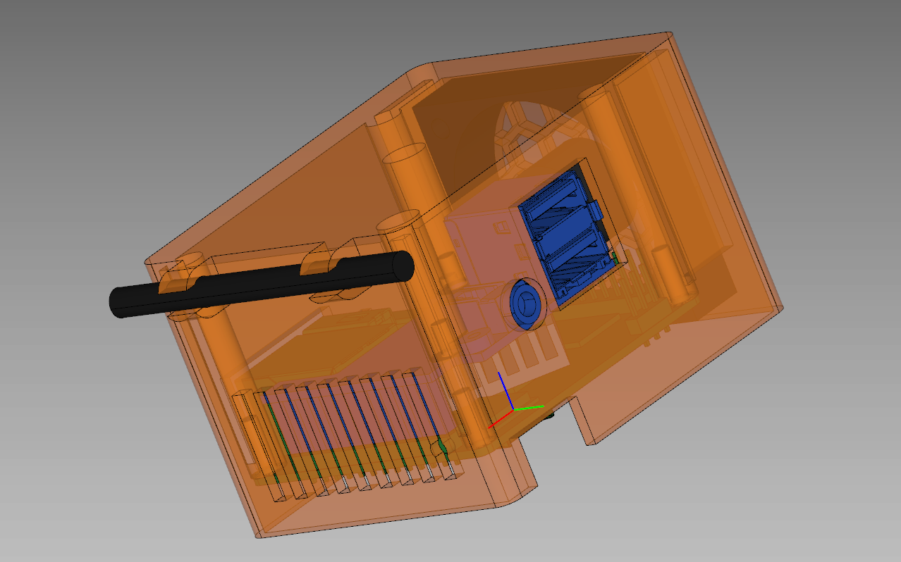

# Case para Orange Pi Zero 3 + placa de expansão USB

Case impresso em PETG para o Orange Pi Zero 3 (2 GB) com a placa de expansão USB. Tem ventoinha 4010 dentro e suporte externo para a antena Wi-Fi redonda.



## Peças

| Peça | Arquivo | Como imprimir |
|---|---|---|
| Tampa | `out/lid.stl` | Teto na mesa |
| Base | `out/base.stl` | Deitada |
| Montagem para conferir | `out/assembly.step` | Não imprime; abrir num visualizador STEP |

## Como gerar de novo

```
.venv\Scripts\python case.py
.venv\Scripts\python tools\fit_check.py
.venv\Scripts\python tools\assembly.py
```

`case.py` tem todas as medidas como variáveis. `tools/fit_check.py` falha se alguma peça encostar onde não deve.

## Mais detalhes

- Plano, montagem e parafusos: `PLAN.md`
- Opções para prender a antena: `ANTENNA-OPTIONS.md`
